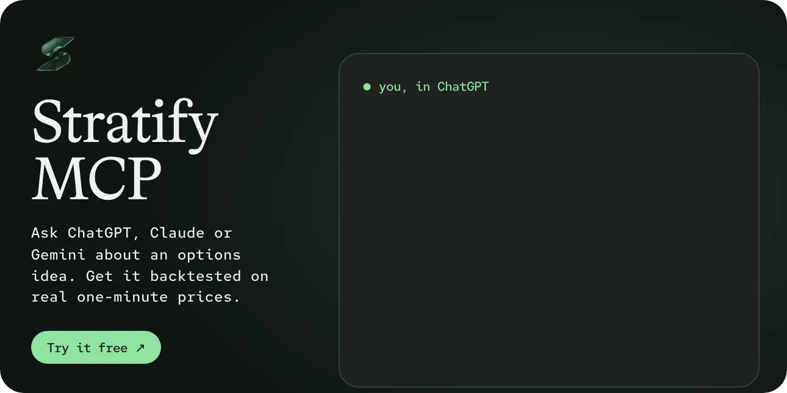
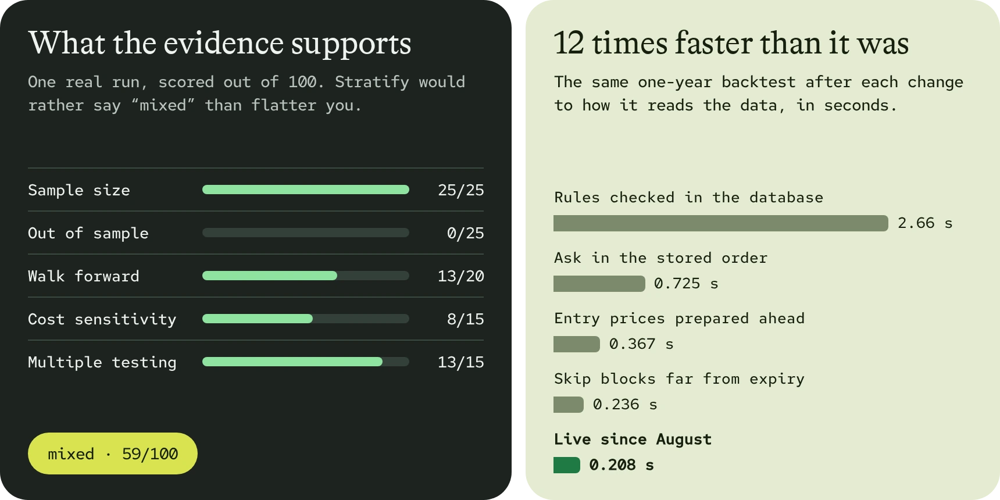
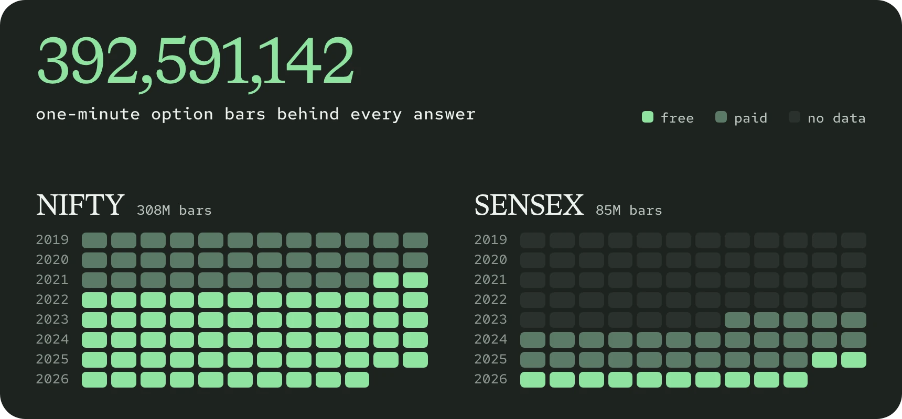

<a href="https://stratify.aeon-labs.site">
<picture>
  <source media="(max-width: 600px)" srcset=".github/readme/stratify-phone.webp">
  
</picture>
</a>

<p align="center">
  <a href="https://stratify.aeon-labs.site"></a>&nbsp;
  <a href="https://stratify.aeon-labs.site/docs"></a>
</p>

<p align="center">
  <a href="https://www.npmjs.com/package/stratify-mcp"></a>
  <a href="https://pypi.org/project/stratify-mcp/"></a>
  <a href="https://github.com/Srinath-exe/stratify-mcp/actions/workflows/ci.yml"></a>
  <a href="LICENSE"></a>
  <a href="https://registry.modelcontextprotocol.io/v0.1/servers?search=site.aeon-labs/stratify"></a>
</p>

Describe an options strategy in plain words, in the assistant you already use. Stratify runs it against every trading day on real one-minute NIFTY and SENSEX option prices, and gives you the result after every charge, with **an honest answer about how far to trust it**.

> *Sell a 20-delta NIFTY strangle every Thursday at 09:30, stop out at 2× the credit, take
> profit at 60%. Did it hold up out of sample?*

It is an [MCP](https://modelcontextprotocol.io) server, so it works in ChatGPT, Claude, Gemini, Claude Code, Codex, Gemini CLI, OpenCode and anything else that speaks MCP. This repository is the code behind the hosted service at **[stratify.aeon-labs.site](https://stratify.aeon-labs.site)**, published so you can read exactly how every number was produced. The service holds **392 million one-minute option bars**: 308 million for NIFTY and 85 million for SENSEX. The market data is not here and never leaves the service: you send a strategy, you get results.

<picture>
  <source media="(max-width: 600px)" srcset=".github/readme/honesty-phone.webp">
  
</picture>

<sub>Measured in November 2026 on the 8-core server. Presets are quicker: a five-year weekly strangle with a 2× stop (259 trades) takes 0.85 seconds, the median of 22 runs with caching off. That is engine time; the run in the film above took 6.7 seconds end to end.</sub>

## Connect in one minute

**No key needed**: these clients sign you in with Google when you add the URL:

| Client | Where | Paste |
|---|---|---|
| **ChatGPT** | Stratify is a published plugin: search for it, or Settings → Plugins → *Create* (Developer mode on) | `https://stratify-mcp.aeon-labs.site/mcp` |
| **Claude** (claude.ai / Desktop) | Settings → Connectors → *Add custom connector* | `https://stratify-mcp.aeon-labs.site/mcp` |
| **Gemini** (web / mobile) | Settings → Connected apps → *custom app* | `https://stratify-mcp.aeon-labs.site/mcp` |

**With an API key**: sign in at [stratify.aeon-labs.site](https://stratify.aeon-labs.site), make a key (`sk_live_…`), then:

```bash
# Claude Code
claude mcp add --transport http stratify https://stratify-mcp.aeon-labs.site/mcp \
  --header "Authorization: Bearer sk_live_..."
```

<details>
<summary>Codex, Gemini CLI, OpenCode, stdio, Python and Claude Desktop</summary>

```toml
# Codex  (~/.codex/config.toml)
[mcp_servers.stratify]
url = "https://stratify-mcp.aeon-labs.site/mcp"
http_headers = { Authorization = "Bearer sk_live_..." }
```

```json
// Gemini CLI  (~/.gemini/settings.json)      — or: gemini extensions install https://github.com/Srinath-exe/stratify-gemini-extension
{ "mcpServers": { "stratify": {
    "httpUrl": "https://stratify-mcp.aeon-labs.site/mcp",
    "headers": { "Authorization": "Bearer sk_live_..." }, "timeout": 120000 } } }
```

```json
// OpenCode  (opencode.json)
{ "mcp": { "stratify": { "type": "remote", "url": "https://stratify-mcp.aeon-labs.site/mcp",
    "enabled": true, "headers": { "Authorization": "Bearer {env:STRATIFY_API_KEY}" } } } }
```

```bash
# Any client that only speaks stdio
STRATIFY_API_KEY=sk_live_... npx stratify-mcp
```

```python
# Python, from a notebook
pip install stratify-mcp
from stratify_mcp import StratifyClient
result = StratifyClient(api_key="sk_live_...").run_backtest({...})   # returns pandas DataFrames
```

**Claude Desktop extension:** download `stratify-<version>.mcpb` from the
[latest release](https://github.com/Srinath-exe/stratify-mcp/releases/latest), double-click,
paste your key once.

</details>

## What it covers

<picture>
  <source media="(max-width: 600px)" srcset=".github/readme/coverage-phone.webp">
  
</picture>

| | Free | Paid |
|---|---|---|
| **NIFTY** options, 1-minute | 1 Nov 2021 – 31 Oct 2026 | 1 Jan 2019 – 31 Oct 2026 |
| **SENSEX** options, 1-minute | 1 Nov 2025 – 31 Oct 2026 | 7 Aug 2023 – 31 Oct 2026 |
| Strategy features | every one | every one |

SENSEX options do not exist in the archive before 7 Aug 2023, so no tier claims earlier
history for it; weekly SENSEX expiries start 31 May 2024 and the months before that are
monthly contracts. The two indices are different contracts with different lot sizes and
strike grids, and each is served from its own database (`engine/db.py`, `SYMBOL_DB`).

**One gap, stated plainly:** the open strategy protocol below (legs + rules) runs on NIFTY
only for now. SENSEX is served through the preset structures (`short_strangle`,
`iron_condor`, `iron_fly`, `credit_spread`, `long_option`), because the open form's entry
gates read a daily market-state table that exists only in NIFTY's database so far.

Free tier limits, per account: up to 100 backtests and 1,000 other calls an hour, two
backtests at once, and 60 CPU-seconds an hour, which a run of heavy five-year custom
strategies reaches first. When the service is busy a backtest waits its turn for up to
20 seconds instead of being refused.

With everyone asking for five years and nobody pausing, twenty people get 51 backtests a
minute between them, none failing (24 Nov 2026). The serving data fits in memory, so the
ceiling is CPU.

The windows are a property of the tier (`engine/spec.py`, `TIER_WINDOWS`), enforced twice: by
the spec validator and by a ClickHouse row policy (`data/schema/70_tiers.sql`,
`71_tiers_symbol.sql`), so a bug in one cannot widen what a free key can read.

## What comes back

Every backtest returns, and every report page shows:

- **P&L after real costs** — brokerage per leg, STT, exchange and SEBI fees, GST, stamp
  duty — and modelled slippage that is *stated as an assumption*, not hidden.
- **Return on margin** from a SPAN calibration measured against a live broker.
- **The honesty panel:** an out-of-sample split (the final 30% is never seen while the
  strategy is being shaped), walk-forward folds, a bootstrap interval on the return, and a
  deflated Sharpe that penalises the number of variants you already tried.
- **No ratio below 30 trades.** A Sharpe on twelve trades is noise; the service says
  `insufficient_sample` instead of a number that looks like evidence.
- **Every trade**, with why it entered and why it exited.
- A **shareable report** — a self-contained page with the equity curve, the rules card in
  plain English, and a browser-side capital view.

The service never calls a strategy good. It shows you what happened and how fragile that is.

## The strategy protocol

A strategy is **legs + rules**, not a preset. Any number of legs on any expiry; strikes by
delta, premium, points or percent; conditions on the position, on the legs, or on the
index; actions that close, roll or open. Thresholds on P&L are fractions, and the field
names say so (`*_frac`); the older `*_pct` names still parse and mean the same fraction.
This exact spec parses and runs:

```json
{
  "legs": [
    {"side": "sell", "type": "CE", "strike": {"delta_near": 0.20}},
    {"side": "sell", "type": "PE", "strike": {"delta_near": 0.20}}
  ],
  "entry": {
    "cadence": "weekly", "dte": 3, "time": "09:30",
    "when": {"all": [{"vix_prev_close": {"gte": 13}}, {"rsi_14": {"lt": 70}}]}
  },
  "rules": [
    {"when": {"pnl_frac_of_credit": {"gte": 0.6}}, "then": "close"},
    {"when": {"leg_mark_mult": {"gte": 2.0, "leg": 0}},
     "then": {"roll": {"legs": [0], "to": {"delta_near": 0.20}}}, "max_times": 1}
  ],
  "portfolio": {"stop_after_losses": 3, "resume_after_days": 30}
}
```

<details>
<summary>The whole vocabulary</summary>

| Vocabulary | |
|---|---|
| Strike selection | `delta_near`, `premium_near`, `pct_offset`, `points_offset`, `atm`, `strike`, `from_leg` |
| Entry gates (market) | `vix`, `vix_prev_close`, `vix_change_pct`, `prev_day_move_pct`, `gap_pct`, `realised_vol_20d`, `day_of_week` |
| Entry gates (index indicators) | `rsi_N`, `close_vs_sma_N_pct`, `close_vs_ema_N_pct`, `ema_F_vs_S_pct`, `sma_F_vs_S_pct` — N from 2 to 250, all on the **previous** close |
| Position conditions | `pnl_frac_of_credit` (0.6 = 60% of the credit), `pnl_frac_of_max`, `credit_kept_frac`, `leg_mark_mult`, `combined_premium`, `drawdown_from_peak`, days/minutes to expiry, clock time |
| Actions | `close`, `close_legs`, `open`, `roll`, `close_and_open` |
| Portfolio | `stop_after_losses`, `stop_after_drawdown_pct`, `skip_after_loss`, `max_trades`, `stop_after_profit_pct`, `resume_after_days` |

</details>

Every gate reads data from *before* the entry moment — the SQL window frames and the
indicator series are built so that lookahead is structurally impossible, not merely
intended. `engine/tests/test_indicators.py` changes a day's close and asserts that day's RSI
does not move.

You never write this JSON by hand: the assistant does, from your sentence. The
`explain_methodology` and `describe_coverage` tools teach it the vocabulary and the limits.

## Tools

| Tool | Does | Writes? |
|---|---|---|
| `run_backtest` | Strategy in; trades, metrics, honesty panel, report URL out | stores the result under your account |
| `build_report` | Turns a stored backtest into a finished, shareable report page | creates a page |
| `describe_coverage` | Symbols, date window, resolution, structures, gates this deployment accepts | no |
| `explain_methodology` | Entry pricing, settlement, costs, margin, slippage, liquidity, overfitting, changelog | no |
| `list_backtests` | Your recent backtests, newest first | no |
| `get_backtest` | Retrieve a stored result by id | no |
| `list_strategies` | Your kept shortlist, ranked by worst walk-forward fold | no |
| `search` · `fetch` | Retrieval in the single-string form ChatGPT deep research requires | no |
| `submit_feedback` · `my_feedback` | Report a wrong answer with repro context attached automatically; see its status | files a report |

All tools carry `title`, `readOnlyHint`, `destructiveHint` and `openWorldHint`, declare
their auth scheme in `_meta.securitySchemes`, and publish an output schema. Nothing is
destructive and nothing reaches outside the service — no broker, no third-party API, no
order placement of any kind. Opening the endpoint URL in a browser shows a page saying what
it is for; clients get the protocol's answer (405, `Allow: POST`).

## For agents and crawlers

```
name            site.aeon-labs/stratify            (official MCP Registry)
endpoint        https://stratify-mcp.aeon-labs.site/mcp
transport       streamable-http (JSON-RPC 2.0 over POST)
auth            OAuth 2.1 (PKCE S256, dynamic client registration, CIMD)
                or  Authorization: Bearer sk_live_...
discovery       https://stratify-mcp.aeon-labs.site/.well-known/oauth-protected-resource/mcp
issuer          https://stratify.aeon-labs.site
open without auth   initialize, tools/list, resources/list, resources/read
needs auth          every tools/call
unauthenticated tools/call → HTTP 401 + WWW-Authenticate (never a 200 wrapping an error)
stdio bridge    npx stratify-mcp        python client   pip install stratify-mcp
market          NIFTY (NSE) and SENSEX (BSE) index options, India; 1-minute; free tier = five years of NIFTY, one year of SENSEX
limits (free)   up to 100 backtests/hour (60 CPU-seconds/hour), 1,000 other calls/hour, per account
data egress     none — results only, never rows
```

## Why the code is open and the data is not

A backtest is a claim about the past, and the only thing separating an honest one from a
flattering one is methodology you cannot see from the outside. Every service in this space
asks you to take its fills, its costs and its margin on faith. So the methodology is here —
the parts that most often hide a lie:

- **[`engine/config/`](engine/config/)** — brokerage, STT, stamp duty, slippage, margin.
  Every constant is either measured against a live broker and says so, or an explicit
  assumption with a stated basis and says that too. There are no bare numbers.
- **[`engine/marks.py`](engine/marks.py)** — how a contract is priced at a point in time,
  including the window frames that make lookahead structurally impossible.
- **[`engine/honesty.py`](engine/honesty.py)** — the floors that force a result to admit a
  thin sample instead of reporting a confident number over eleven trades.
- **[`engine/strategy.py`](engine/strategy.py) · [`engine/simulate.py`](engine/simulate.py)**
  — the open strategy protocol: a closed vocabulary, no `eval` anywhere.
- **[`engine/methodology.py`](engine/methodology.py)** — every result is stamped with the
  methodology version that produced it, so a number you recorded last month is
  attributable when the model improves.

The data is a licensed, cleaned, multi-year archive of one-minute bars. It is the one thing this
repository does not contain and cannot fetch; there is no route that returns rows, and a
test asserts there never will be.

## Read more

- [Backtesting 392 million option bars your AI never sees](https://stratify.aeon-labs.site/guides/backtesting-372-million-option-bars-compute-to-data-mcp-server): the architecture, in thirteen pictures
- [How to backtest options strategies with AI](https://stratify.aeon-labs.site/guides/how-to-backtest-options-strategies-with-ai): setup, prompts, and ten strategies over five years
- [Where ChatGPT's backtest answer comes from](https://stratify.aeon-labs.site/guides/chatgpt-options-backtest-where-the-answer-comes-from): why the engine runs on a server and the AI only writes the spec

## Layout

```
engine/      Spec in, trades and evidence out. Pure Python, ClickHouse for prices.
server/      MCP service, OAuth 2.1 authorization server, website, dashboard, reports, quotas.
data/        ClickHouse schema and per-tier settings profiles (schema only, no data).
packages/    npm client + stdio bridge, Python client, Claude Desktop bundle, Gemini CLI
             extension, MCP Registry entry. Released from tags; see packages/stratify-npm/PUBLISHING.md.
tests/       Adversarial suites: 100-strategy uniqueness sweep, exotic specs, market gates, persona evals.
docs/        Design record, frozen at the dates in each header.
vendor/      Runtime inputs the engine loads but does not ship. Read vendor/README.md.
```

## Running it yourself

You need a ClickHouse instance holding options data in the schema under `data/schema/`.
This repository contains no data and cannot fetch any; with no database, the suite skips
the tests that need one and says so.

```bash
pip install -r requirements-dev.txt
python3 -m pytest engine/tests server/tests -q -rs   # without a database: 497 pass, 230 skip (CI, 24 Nov 2026)
cp .env.example .env                                  # then fill it in
./server/run.sh
```

`run.sh` refuses to start without `STRATIFY_KEY_PEPPER`, deliberately: the default is a
development value, and starting with it would hash every API key against a constant printed
in this repository. [`docker-compose.example.yml`](docker-compose.example.yml) is the
container deployment; [`SECURITY.md`](SECURITY.md) describes the trust boundaries it depends
on and how to report a vulnerability privately.

## Tests worth reading

`tests/torture_100.py` builds 100 strategies that are pairwise distinct on four axes —
entry, position, management, exit — and refuses to run if any two collide. It found bugs
unit tests did not: two chart resolutions that had never once executed, a guard that
discarded legitimate ratio spreads, and margin that ignored quantity.

`tests/persona_eval.py` drives a real model through the live MCP as several personas. It
caught a guardrail failure no unit test could have.

`server/tests/test_mcpauth.py` names, per test, the OAuth attack it prevents — code replay,
refresh-token reuse, redirect-URI substitution, PKCE downgrade — rather than asserting that
the happy path works.

## Contributing

The most useful contribution is checking the arithmetic — a wrong number that looks
plausible is the failure that matters here. [CONTRIBUTING.md](CONTRIBUTING.md) covers
setup, house style, and the one rule that is not optional: if a change makes an unchanged
spec return different numbers, the methodology version gets bumped.

## Licence

MIT — see [LICENSE](LICENSE). `server/vendor/lightweight-charts.js` is TradingView
Lightweight Charts™, Apache 2.0, redistributed with its licence header intact.

Backtests are historical simulation, not advice. Nothing here is a recommendation to trade.

Built and run by [Srinath H](https://github.com/Srinath-exe). The other one: [OpenATC](https://github.com/Srinath-exe/OpenSkyATC).
